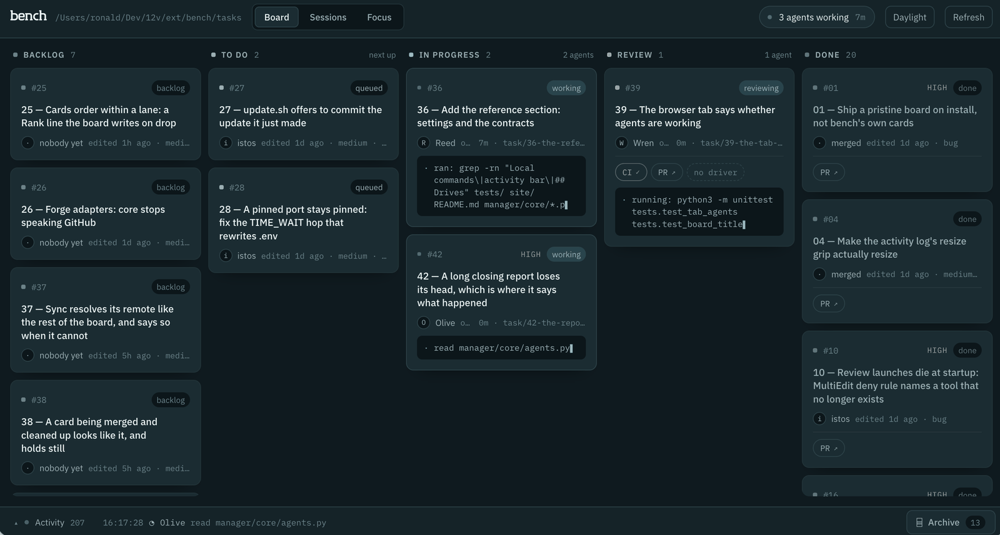

# Bench

A live kanban for coding-agent work: task files in stage directories are
the only source of truth; a stdlib-only board narrates everything that
happens to them — agents working in git worktrees, PRs opening on review,
CI and Copilot state on the cards, drives of the app from a task's own
branch, and an archive that is never a delete. Work that is a run of
related cards rather than one is a **phase**: a card that lists its
cards, an integration branch of its own, and members branched from it,
run one at a time and merged back on green — ending in a single PR into
`main` for a human. Turn on team mode
(`BOARD_SYNC=1`) and the truth is `origin/main`: moves commit and push
themselves, every board pulls on a beat, and the person who claimed a
card first keeps it.

Nothing merges on an agent's word. Your team provides the checks; bench
runs them against the exact commit, records the result, and each card
says in one word what is happening, the one thing to do next, and which
merge requirements are met — counting only what you made required. The
usual setup is one required check and one review; anything more is a
deliberate choice of distinct assurance ("From evidence to merge" in the
docs).

**Docs: [bench.12vectors.com](https://bench.12vectors.com)** — guides,
concepts, and a settings reference, every page of it generated from this
repository's own markdown, so what the docs say and what bench does
cannot drift apart.



*bench's own board, running on this repository. Three agents at work,
each on its own branch — and every one of them stops at review.*

## Install into a repo

```bash
mkdir .task-manager && curl -L \
  https://github.com/12vectors/bench/releases/latest/download/bench.tar.gz \
  | tar -xz -C .task-manager
./.task-manager/start.sh        # wires the project (idempotent) and serves
```

No token, no clone: releases are curated artifacts that never contained
bench's own cards or settings, so the board starts empty by construction.
They carry no work state at all: `start.sh` runs `install.py`, which
creates `tasks/` (five stages and `archive/`), `plans/` and `reference/`
inside `.task-manager/` and seeds `tasks/task-template.md` from the
tool-owned `manager/core/seed/`. That template is yours from then on.

The first run asks the two questions it cannot answer for you — solo or
team, and which agent adapter — and writes `manager/local/.env` from the
documented example, so every other setting is discoverable in your own
copy. What runs your tests is read off the project rather than asked
(`package.json` → `npm test`, and so on); nothing recognisable leaves
`BOARD_AGENT_COMMANDS` empty, and that is the key to set before an agent
can run them. Bare Enter takes the default
throughout; with no terminal (CI, a script) it asks nothing and
`install.py --setup` asks later.

Commit `.task-manager/` into the host repo — core is vendored on purpose,
so clones work offline and updates show up in the host's own diffs.

The workflow brief ships as `.task-manager/AGENTS.md` — the cross-vendor
name coding agents read natively — with `CLAUDE.md` beside it as a one-line
compatibility pointer. Both live inside `.task-manager/`, so a host repo's
own root `AGENTS.md` is never touched.

## Install outside the repo

Bench does not have to live in the repository it manages. Name an
application and a work state of its own and nothing of bench — not the
tool, not a task file, not one bookkeeping commit — ever appears in that
application's history. Four locations, each named separately:

```text
workspace/                       # a grouping directory, not a repo
├── app/        BOARD_APP_ROOT   # the application + its own origin
├── bench/                       # this install: tool and configuration
├── work/       BOARD_WORK_ROOT  # tasks/, plans/, reference/ — its own repo
└── worktrees/  BOARD_WORKTREES  # the application's task branches
```

```bash
mkdir -p /ws/bench && curl -L \
  https://github.com/12vectors/bench/releases/latest/download/bench.tar.gz \
  | tar -xz -C /ws/bench
python3 /ws/bench/install.py --app /ws/app --work /ws/work
/ws/bench/start.sh
```

`--app` and `--work` must be absolute: bench resolves nothing against a
working directory it cannot see. The install writes both into
`manager/local/.env`, builds the work state's skeleton — at the work
root only, so `/ws/bench` is left with no `tasks/`, `plans/` or
`reference/` that could pass for a second board — and wires the
agent adapter — and refuses the whole layout, with the reason, rather
than falling back to a repository nobody named. `--worktrees` moves the
task branches' checkouts; `--app-hooks` additionally writes the
application's *local* settings file, and refuses if git tracks it.
`--dry-run` reports and writes nothing. Later runs need no flags: the
layout is read back from `manager/local/.env`, and nothing that exists
is overwritten. A work root that already holds a board keeps it, your
edited task template included; an older install's untouched skeleton
beside the tool is tidied away, and anything there that is not untouched
is kept and named rather than moved or deleted. Changing the work root
later initializes the new one and leaves the old one exactly as it was.

Two git identities, and they never cross. Branches, worktrees, pushes and
code PRs are the application's; creating, moving and archiving a ticket
is the work state's. The tickets are local-only until you `git init`
their root, versioned by the board once `BOARD_COMMIT_MOVES` is on, and
shared with `BOARD_SYNC` through the work state's own
`BOARD_STATE_GIT_REMOTE` and `BOARD_STATE_BASE`. A card moving columns
cannot commit on the application's base, a code PR cannot target the
work-state remote, and merging into the application's base is still your
click. Runtime state — agent logs, session timelines, the generated
hooks, the recorded execution plans and their machine-local paths —
stays with the tool and is committed nowhere.

The whole of it is the "Running outside the application" section of
[AGENTS.md](AGENTS.md), which is where these docs cut their two pages on
it from: **External workspaces** — the four roots, the two git
identities, how far the tickets are versioned, where a card's branch is
planned, and what a layout that does not hold together is refused with —
and **Operating an external install**, for hook wiring without a tracked
file, what the record says about where things are, start/stop/update, and
running a candidate bench from a stable operator install.

## Set up with your coding agent

`bootstrap.py` is the guided way into the external layout above, written
to be run by a person or handed to their coding agent. It looks first,
shows you every change it would make, and makes them only when you say
so — then it gives you the board's address and stops. It is not a second
installer: the installing is `install.py`, which it runs for you with
the flags above.

### The bounded instructions

Paste this into your coding agent, with the two paths filled in. It is
bounded on purpose: the agent reads, asks and previews on its own, and
every change waits for you.

```text
Set up Bench for my project with Bench's bootstrap.py. The application
is /ws/app and Bench is unpacked at /ws/bench. Stop at every decision
that is mine.

1. Run: python3 /ws/bench/bootstrap.py inspect --app /ws/app
   It writes nothing and runs nothing from the project. Summarise what
   it found, including anything it says it refused.
2. Run plan with the same --app. For each choice it lists under
   "Still to choose", ask me — do not choose for me.
3. Run plan again with my answers and show me every operation it
   previews, exactly as printed.
4. Only after I approve, run the same command with apply instead of
   plan, and with --yes added.
5. Never add --create-remote, --add-remote, --push or --sync unless I
   asked for that one by name. Never ask me for a token or a password:
   if a provider needs signing in, tell me to run its login myself, in
   my own terminal.
6. Report the board URL, the handoff file path and the "Left for the
   guide" items it printed, then stop. Do not start the board unless I
   ask.
```

### The commands, and what each one does

```bash
mkdir -p /ws/bench && curl -L \
  https://github.com/12vectors/bench/releases/latest/download/bench.tar.gz \
  | tar -xz -C /ws/bench
python3 /ws/bench/bootstrap.py inspect --app /ws/app
python3 /ws/bench/bootstrap.py plan --app /ws/app --work-repo new --agent claude --behaviour solo
python3 /ws/bench/bootstrap.py apply --app /ws/app --work-repo new --agent claude --behaviour solo --yes
/ws/bench/start.sh
```

- **`inspect`** reads and reports: the application's real root (the top
  of the git checkout you named), its branch, remotes and uncommitted
  paths; any bench already installed there or beside it; whether the
  work root is a repository of its own; which of `git`, `gh` and the
  agent CLIs are on your PATH; and what the project *declares* —
  instructions, CI workflows, `package.json` scripts, `Makefile`
  targets. It writes nothing. It runs no project script, and it asks git
  with the repository's filesystem monitor and hooks turned off, so not
  even the repository's own configuration runs. A script called `test`
  is reported as declared — never as safe, and never as approved.
- **`plan`** resolves your choices, refuses a layout that does not hold
  together, and previews every filesystem, git, settings and network
  operation `apply` would make. It writes nothing either.
- **`apply`** makes exactly those operations, in order, once approved
  with `--yes` (or by answering on a terminal). Without a terminal and
  without `--yes` it asks nothing, prints the preview and exits 2.
  `--start` starts the board when it is done; otherwise it never does.

Every subcommand takes `--json`, which prints the handoff document
below instead of prose, and `--help`, which lists the options. There
are no others.

### The choices it asks for, and nothing else

| Choice | Option | Asked when |
| --- | --- | --- |
| the application | `--app PATH` | always — an absolute path to its git checkout |
| the tickets' repository | `--work-repo new`, `existing` or `none` | the work root is not already a repository. `new` runs `git init` there with your consent; `none` keeps a plain folder |
| the agent | `--agent claude` (or another installed adapter) | more than one adapter is installed and none is set |
| solo or team | `--behaviour solo` or `team` | nothing is set yet. Team makes moves claim the card and commit themselves |

The rest have defaults and are only ever your explicit choice: the work
root (`--work`, default `work` beside this install) and the worktrees
(`--worktrees`, default `worktrees` beside it); `--access remote`, which
prints how to reach the board through an SSH tunnel and does not change
where it listens; `--create-remote OWNER/NAME`, which creates a
**private** GitHub repository for the tickets through `gh`;
`--add-remote URL`; `--push`, the first push of the tickets; and
`--sync`, which shares the board through that remote (`BOARD_SYNC`).
Each is a separate decision, and none of them touches the application.
`--mode vendored` keeps the older layout — bench inside the
application's own `.task-manager/` — for an install unpacked there.

### What it will not do

- Move, edit, commit or push anything in the application. The
  application is never pushed or merged by setup.
- Reinitialize a repository, or add or replace a remote on one that has
  one. An existing work repository is used exactly as it is, and an
  existing board in it keeps its cards and its template.
- Accept a URL carrying a credential, ask for a token, or print one: a
  provider's sign-in (`gh auth login`, your agent CLI's own login) runs
  in your terminal, outside bench.
- Create a public repository, start a network listener, or bind the
  board anywhere but `127.0.0.1`.
- Choose which commands an agent may run. A fresh board starts with
  `BOARD_AGENT_COMMANDS` empty and says so on the board.
- Call a model. Seeing that the agent CLI is on PATH is all `inspect`
  does; `board.py --doctor --real-agent --approve-real-agent` is the
  separate, explicit check that spends tokens.

It refuses — writing nothing — an application that is not a git
repository, two roles that are the same directory or nest inside one
another, a work root inside a repository it does not own, a bench that
sits inside the application in the external mode, and an install
already set up for a different application.

### When something is missing or goes wrong

A missing optional capability is a line under **Left for the guide**,
not a failure: no `gh`, no agent CLI, no remote, a remote GitHub refused
to create, a first push that did not land. The local board works in
every one of those cases. A required step that fails — the install
itself — stops the run with exit 1 and its output. A run that is
interrupted, or fails part way, is resumed by running the same command
again: every step looks at what is already there first, so nothing is
done twice and nothing is undone.

Exit status: `0` done, `1` refused or a required step failed, `2` a
choice or the approval is missing, `130` interrupted.

### The handoff, and where to go next

Every run ends with a handoff — printed, and with `apply` also written
to `manager/local/state/bootstrap/handoff.json`, which is machine-local
and never committed. It is versioned (`"kind": "bench-bootstrap-handoff"`,
`"v": 1`) and holds the roles, your choices, each operation's outcome,
the items left for the guide, and the board's real address
(`http://127.0.0.1:26071/` unless `BOARD_PORT` says otherwise). No
credential, token or environment value is ever in it.

Then start the board with `start.sh` and open that address. The **⚕
configuration** chip in its header is where setup continues: what is
configured, what is not, and what to do next, with **Settings** holding
the rest — the commands agents may run, the checks your team provides,
and the merge rules.

## Update

```bash
./.task-manager/update.sh              # latest release
BENCH_REF=v2 ./.task-manager/update.sh # an exact release tag
```

The artifact is stamped with the repo it was built from, so updating
needs no configuration; `BENCH_SOURCE=<owner/repo>` in
`manager/local/.env` overrides the stamp. Updates replace
`manager/core/` and the top-level scripts wholesale and touch nothing
else — tasks, plans, reference, your task template, and everything under
`manager/local/` (your driver, commands, prompt overrides, settings,
state) survive every update, wherever the work root is. Only the
tool-owned seed in `manager/core/seed/` changes. Then
`python3 .task-manager/install.py` and restart the board.
If the source repo has no published release yet, `update.sh` says so and
changes nothing.

## Working on bench itself

```bash
git clone git@github.com:12vectors/bench.git && cd bench && ./start.sh
```

A clone carries bench's own cards and local/ content — that is dev mode,
not an install. (Installing from a clone anyway works: `install.py`
clears the shipped cards on its first boot in a host repo.) In the clone
the task template lives at `manager/core/seed/task-template.md`, the seed
every install copies from. Releases are
built by `./release.sh` from the manifest at
`manager/core/release-manifest`: tag = `v<VERSION>`, one stable asset
name (`bench.tar.gz`), contents at the tarball root — the two things the
install one-liner above depends on.

Bench's own checks live in `verify/` (see `verify/README.md`):
`verify/backend` runs the whole suite and refuses a skip, `verify/docs`
builds this site, and `verify/browser` drives the board in a sandboxed
Chromium. `python3 verify/gate-compare` reads an existing board's gates
with two resolvers — the installed one and a candidate — on private
copies, and explains every reading that would change before you promote
anything; it writes nothing it reads from.

## The three-layer law

Core knows about tasks, worktrees, PRs and events. It knows nothing about
any particular app (drivers do: `manager/local/driver/start`), agent
vendor (adapters do: `manager/core/adapters/`), or project
(`manager/local/` does).

The consequence is what makes an update safe: `update.sh` replaces
`manager/core/` wholesale, and everything a project taught bench about
itself lives outside it. Full docs in [AGENTS.md](AGENTS.md) — the file
the docs site is cut from, and the one an agent working in your repo
reads; the adapter contract in
[manager/core/adapters/README.md](manager/core/adapters/README.md).

## License

[MIT](LICENSE).
